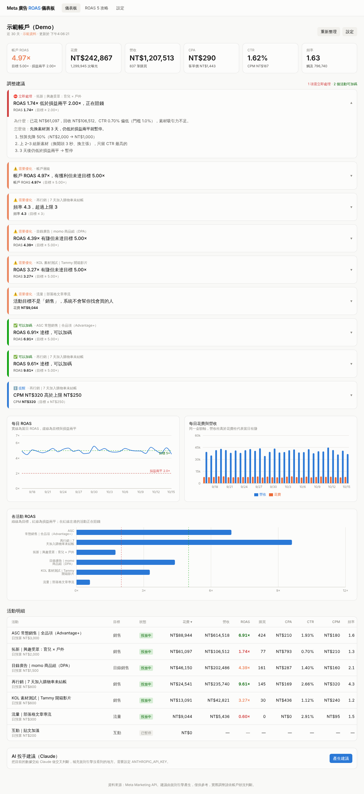

# Meta 廣告 ROAS 儀表板

監看 Meta 廣告成效，並依規則引擎給出「把 ROAS 拉到目標」的具體調整建議。可選擇再接 Claude 做交叉判斷。



## 功能

- **儀表板**：帳戶 ROAS／花費／營收／CPA／CTR／頻率六大指標、每日 ROAS 趨勢（含目標線與損益兩平線）、每日花費 vs 營收、各活動 ROAS 排行、活動明細表
- **調整建議**：規則引擎依「損益兩平 ROAS、目標 ROAS、判斷門檻花費、頻率上限、CTR 下限、CPM 上限」判斷每個活動該暫停、加碼還是優化，並給出可直接照做的步驟
- **AI 投手建議**：設定 `ANTHROPIC_API_KEY` 後，把目前數據交給 Claude（claude-opus-5-5）做補充判斷
- **設定頁**：Meta 存取權杖、廣告帳戶、幣別、分析區間、目標 ROAS、毛利率與各項門檻；可測試 Meta 連線
- **ROAS 5 攻略**：追蹤、活動結構、出價、素材、落地頁、每日操作節奏的完整指南
- **示範模式**：沒有權杖也能先看功能（預設開啟）

## 啟動

```bash
npm install
cp .env.example .env.local   # 選填，也可以在設定頁填
npm run dev
```

打開 http://localhost:3000 。

## 接 Meta 即時資料

1. 依 `docs/meta-mcp-setup.md` 第五節產生系統用戶權杖（`ads_read`）。
2. 到「設定」頁貼上權杖、填廣告帳戶 ID（純數字）、關掉「使用示範資料」、按「測試 Meta 連線」。
3. 權杖只存在伺服器端的 `data/settings.json`（已在 `.gitignore`），不會傳到瀏覽器。

## 部署到 Cloudflare Workers

目前的正式網址：https://meta-ads-roas-dashboard.xboomz.workers.dev

```bash
export CLOUDFLARE_API_TOKEN=...   # 或先 npx wrangler login
npm run deploy                     # OpenNext build + wrangler deploy
```

Workers 上沒有可寫的檔案系統，設定頁的儲存只會保留到實例重啟。要長期使用請設 secrets：

```bash
npx wrangler secret put META_ACCESS_TOKEN
npx wrangler secret put META_AD_ACCOUNT_ID
npx wrangler secret put DASHBOARD_PASSWORD   # 設了之後整站需要密碼（帳號隨意）
npx wrangler secret put ANTHROPIC_API_KEY    # 選填，啟用 AI 建議
```

設定 secrets 後要再 `npm run deploy` 一次。也可以在 Cloudflare 後台 Workers & Pages → meta-ads-roas-dashboard → Settings → Variables and Secrets 裡設定。

## 專案結構

```
app/                 頁面與 API 路由（Next.js App Router）
  page.tsx           儀表板
  settings/          設定頁
  playbook/          ROAS 5 攻略
  api/insights       取得指標 + 建議
  api/settings       讀寫設定
  api/test-connection 測試 Meta 權杖
  api/advice         Claude AI 建議
components/          圖表、表格、建議清單
lib/
  meta.ts            Meta Marketing API 客戶端
  demo.ts            示範資料
  rules.ts           規則引擎（建議怎麼產生都在這）
  insights.ts        組合資料來源 + 規則
docs/
  meta-mcp-setup.md  Meta Ads MCP 串接教學
```

## 調整規則

所有建議邏輯都在 `lib/rules.ts`，門檻在設定頁改。要加新規則就在 `buildRecommendations` 裡加一段。
